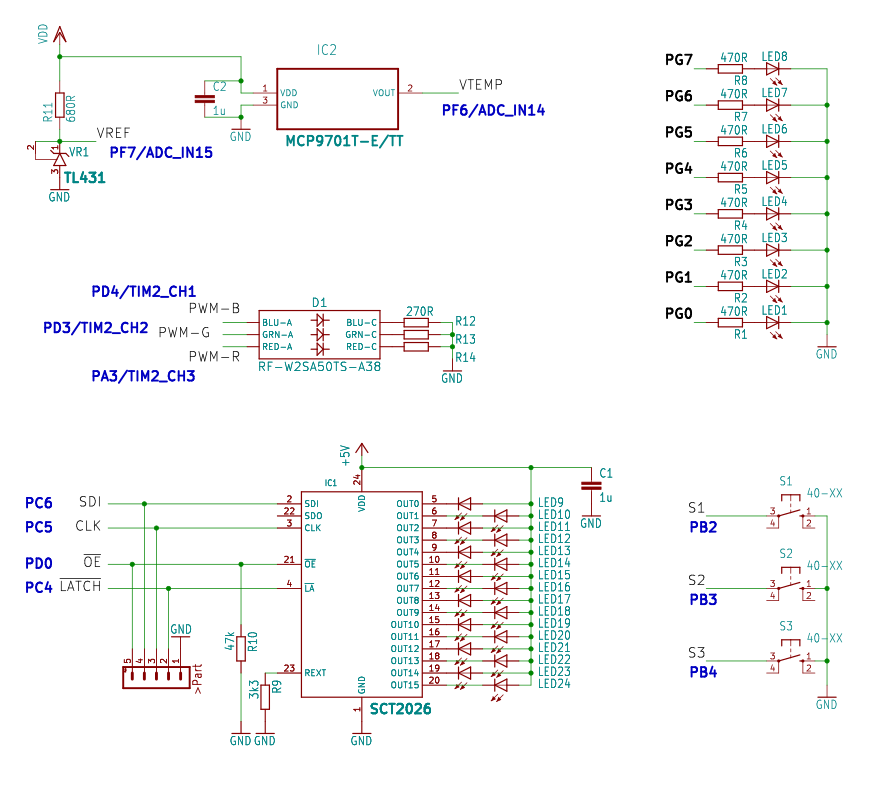

# Stm8_2 Ovladani tlacitka, tlacitko prepina svit LED

## Účel/Zadání/Funkce

* tlacitko reaguje na haranu
* kdyz tlacitko pustim, prepne se svit LEDky

## Schéma zapojení

## Popis funkce

Zmacknu tlacitko a reversne se stav LEDky

## ToDo

* ještě chybí tamto

## Zhodnocení

SU sikovne

Svou práci bych ohodnotil výborně. Nepracoval jsem sice samostatně,
ale nakonec jsem hotový projekt smazal a vytvořil ho celý znovu sám.

CHCI 1****